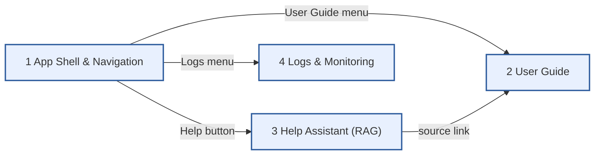

# 0. Overview - Scenario Map

Template app: left menu with the project's main feature (Home), the User Guide, a Help assistant
that answers from the User Guide (RAG), and Logs & Monitoring with natural language log search.
Click a box to open its flow.

