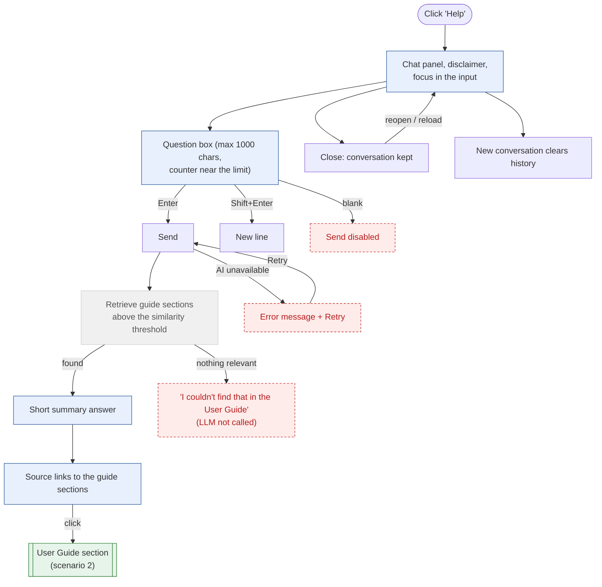

# 3. Help Assistant (RAG)

Answers how to use the app from the User Guide only: the question is embedded, similar guide
sections are retrieved from Vectorize, and the LLM writes a short summary. Links to the sections
come from the server, not from the model.

