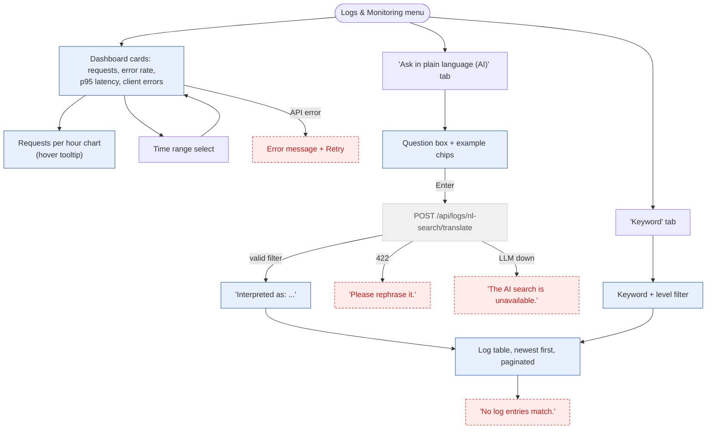

# 4. Logs & Monitoring

Every API request is logged to the `RequestLog` table (and Cloudflare Workers Logs). The page shows a
dashboard and searches the table in plain language: the LLM turns the question into a JSON filter,
the backend validates it against the log catalogue and runs it through the Django ORM.

