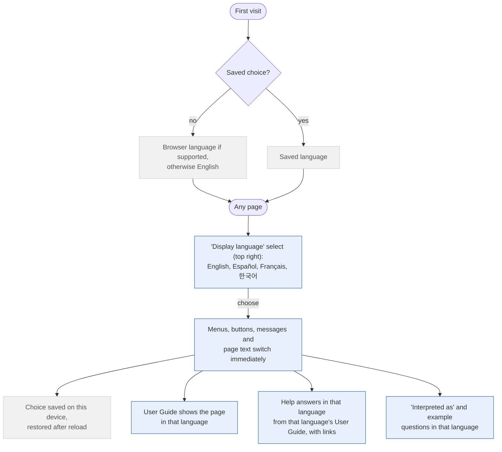

# 5. Languages

The whole app (menus, pages, User Guide, Help assistant, natural language descriptions) is available in
English, Spanish, French and Korean. Developer reports (coverage report, UX flows) stay in English.

